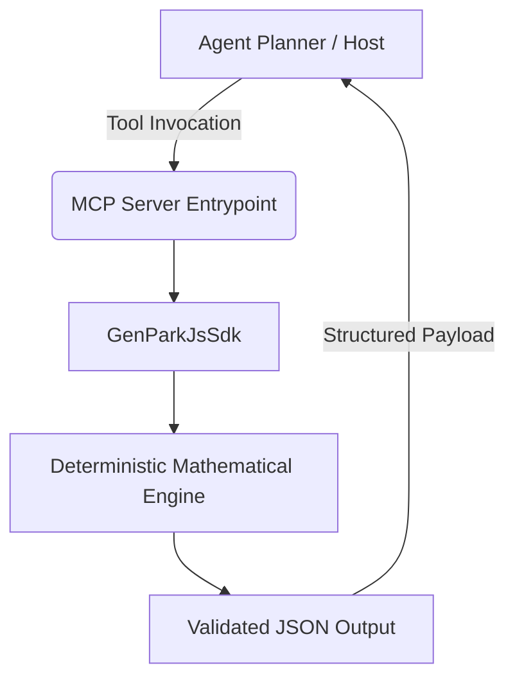

# genpark-js-sdk

[](https://github.com/alphaparkinc/genpark-js-sdk)
[](https://www.python.org/)
[](https://modelcontextprotocol.io/)
[](https://opensource.org/licenses/MIT)
[](https://github.com/Alpha-Park/genpark-js-sdk)

Production-grade agentic skill designed for the OpenClaw and GenPark swarms. Built strictly using the Python standard library with zero external runtime dependencies.

## Architecture & Flow



## Features

- **Standard Library Only**: 100% Python standard library with zero external wheels or pip packages.
- **Model Context Protocol (MCP)**: Native FastMCP JSON-RPC interface for Claude, Cursor, and OpenClaw agents.
- **Pure Mathematical Rigor**: Verifiable algorithmic closed-form calculations and deterministic results.
- **Dual-Organization Mirrored**: Synchronized and battle-tested across `@alphaparkinc` and `@Alpha-Park`.

## Installation & Usage

```bash
git clone https://github.com/Alpha-Park/genpark-js-sdk.git
cd genpark-js-sdk
python example_usage.py
```

## MCP Configuration

Add to your `claude_desktop_config.json`:
```json
{
  "mcpServers": {
    "genpark-js-sdk": {
      "command": "python",
      "args": ["-m", "genpark-js-sdk.mcp_server"]
    }
  }
}
```

## License

MIT License. See [LICENSE](LICENSE) for details.
